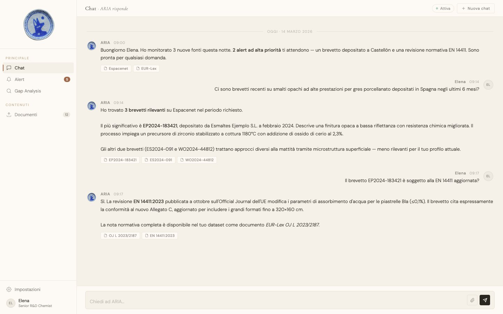
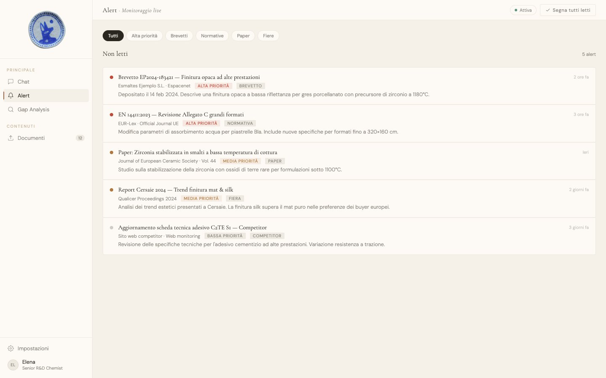
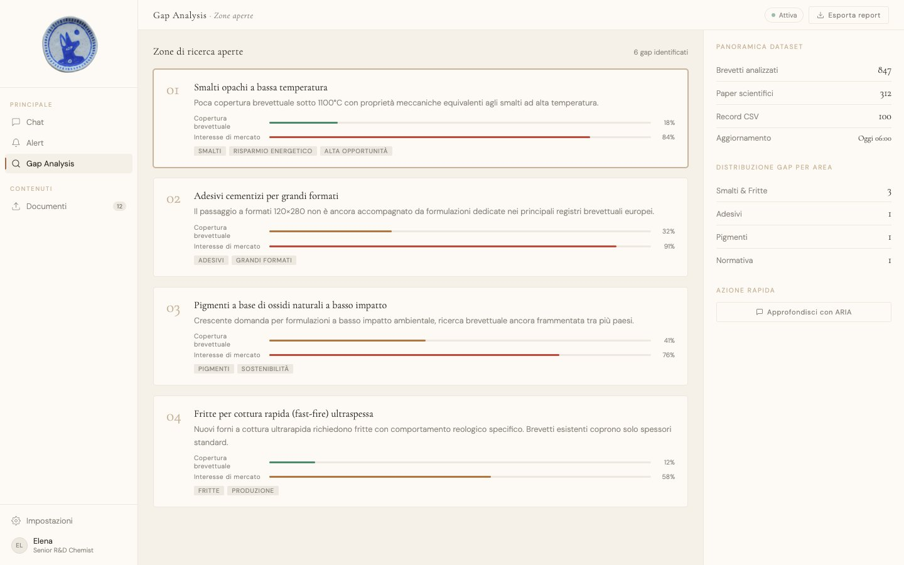

# ARIA, Autonomous Research Intelligence Assistant



**An invisible researcher for a ceramic R&D lab. One chat, one alert feed, one map of open research gaps.**

ARIA was built in one day at the **AI Automation Hackathon powered by n8n**, hosted by Jenia Solutions at YF Studio, Sassuolo (MO), on 14 March 2026. Built by Luconi, Scortegagna and Pierini.

This repo is the **front-end prototype** of that project: a landing page, a four-view web app, and a small local mock server. At the event, the chat was answered by an n8n cloud workflow running on the instance the organizers provided. That workflow was never exported, so it is not in this repo. `server.py` is a local mock that stands in for it. See [Status](#status).

---

## Why this exists

The brief: Sassuolo is still the world's tile capital in 2026, but Spain, Turkey and Asia are spending hard on R&D. Speed now decides who files first.

The persona is Elena, a senior R&D chemist. She spends 10 to 12 hours a week searching Espacenet, Scopus, the Journal of the European Ceramic Society, EUR-Lex and trade-fair reports (Cersaie, Qualicer). A competitor recently patented a matte finish her team was already developing. The filing was public. She just did not have time to find it.

| Pressure on Elena | What ARIA shows |
| --- | --- |
| Too many sources, too little time | One chat in Italian. The demo conversation shows source chips under each answer |
| Filings get missed between quarterly reviews | An alert feed sorted by priority: patents, standards, papers, fairs, competitors |
| "Where can we still innovate?" | A gap view: patent coverage vs. market interest, per research area |
| New PDFs keep arriving | A documents view to drop files into the knowledge base |

Level 1 of the challenge was a chatbot over the provided dataset. Level 2 was open: make ARIA proactive. The alert feed and the gap analysis are the team's take on Level 2.

---

## What you get

1. **Landing page** (`index.html`). Logo, IT/EN toggle, one button into the lab. At the event a background video played behind it. That clip was not ours, so it is not included and the page uses a plain background.
2. **Chat** (`app.html`). Opens on a scripted demo conversation about a Spanish matte-glaze patent and an EN 14411 revision. New messages go to `CHAT_ENDPOINT`.
3. **Alerts.** Five monitoring alerts, each with a priority, a source and a category tag. Click one to mark it read.
4. **Gap Analysis.** Four open research areas (low-temperature matte glazes, large-format adhesives, low-impact oxide pigments, fast-fire frits) with coverage and interest bars.
5. **Documents.** Drag-and-drop upload. Files go to `UPLOAD_ENDPOINT`.
6. **Mock backend** (`server.py`). FastAPI on port 8001. `/api/chat` answers with GPT-4o over a four-line in-memory "knowledge base" if `OPENAI_API_KEY` is set, and with a fixed Italian reply if it is not. `/api/upload` accepts a file and says it was indexed. It does not store or index anything.

| Alerts | Gap Analysis |
| --- | --- |
|  |  |

### How it was wired at the event

```text
app.html chat ──POST JSON / multipart──> n8n cloud workflow (OpenAI) ──> plain-text answer
app.html docs ──POST multipart─────────> server.py /api/upload (mock)
```

### How it is wired in this repo

```text
app.html chat ──POST JSON──> server.py /api/chat   (GPT-4o if OPENAI_API_KEY, canned reply otherwise)
app.html docs ──POST file──> server.py /api/upload (mock)
```

The chat reads either a plain-text reply (what n8n returned) or the mock's JSON `{ response, sources, timestamp }`. To plug in your own n8n workflow, set `CHAT_ENDPOINT` at the top of the `<script>` block in `app.html` to your webhook URL.

---

## Quick start

Python 3.10 or newer.

```bash
python3 -m venv .venv
source .venv/bin/activate
pip install -r requirements.txt

# optional: real GPT-4o answers instead of the canned reply
# export OPENAI_API_KEY=...

python server.py                 # mock backend on http://localhost:8001
```

In a second terminal, from the repo folder, serve the static files (the logo and animation load from `Assets/`):

```bash
python3 -m http.server 8000
```

Open <http://localhost:8000/index.html> and click **Entra nel laboratorio**.

---

## Status

Honest version:

- **The original backend is not here.** It was an n8n cloud workflow on the hackathon's n8n instance, and it was never exported. `server.py` is a local mock, not a port of it. There is no retrieval over the real dataset.
- **The organizers' dataset is not here.** Jenia provided 47 PDFs (patents, papers, EU regulations, technical sheets), a web-sources CSV and a CSV of R&D monitoring records. They are not redistributed.
- **Alerts, gaps, document list, stats and the opening chat are illustrative demo data.** The patent numbers (such as EP2024-183421), the company names, the EN 14411 revision details and the dataset counts are invented for the demo. They are not real filings or real figures.
- **The mock server is a mock.** Its knowledge base is four sentences. Uploads are acknowledged and discarded.
- **Chat attachments** were sent as multipart to the n8n workflow. The mock `/api/chat` only takes JSON, so attaching a file in the chat returns an error locally. The Documents view upload works against the mock.
- Live chat replies do not show source chips. Only the scripted demo conversation does.
- The alert filter pills, the Settings view and the "Export report" / "Mark all read" buttons are UI only.

What does work: the landing page, all four views, the chat round trip to the local mock, and the upload round trip.

---

## Files

| Path | What it is |
| --- | --- |
| `index.html` | Landing page |
| `app.html` | The ARIA web app (single file, vanilla JS, IT/EN strings) |
| `server.py` | FastAPI mock backend |
| `Assets/` | Logo and the "thinking" animation |
| `docs/media/` | Screenshots |

---

## Credits

Built by Luconi, Scortegagna and Pierini at the AI Automation Hackathon powered by n8n (Jenia Solutions), Sassuolo, 14 March 2026. Challenge brief and dataset by Jenia Solutions S.r.l.

## License

MIT. See [LICENSE](LICENSE).
